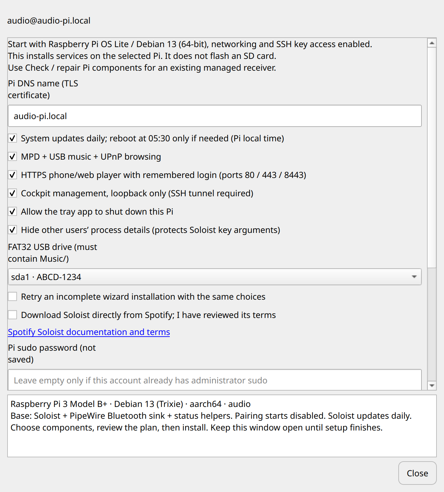
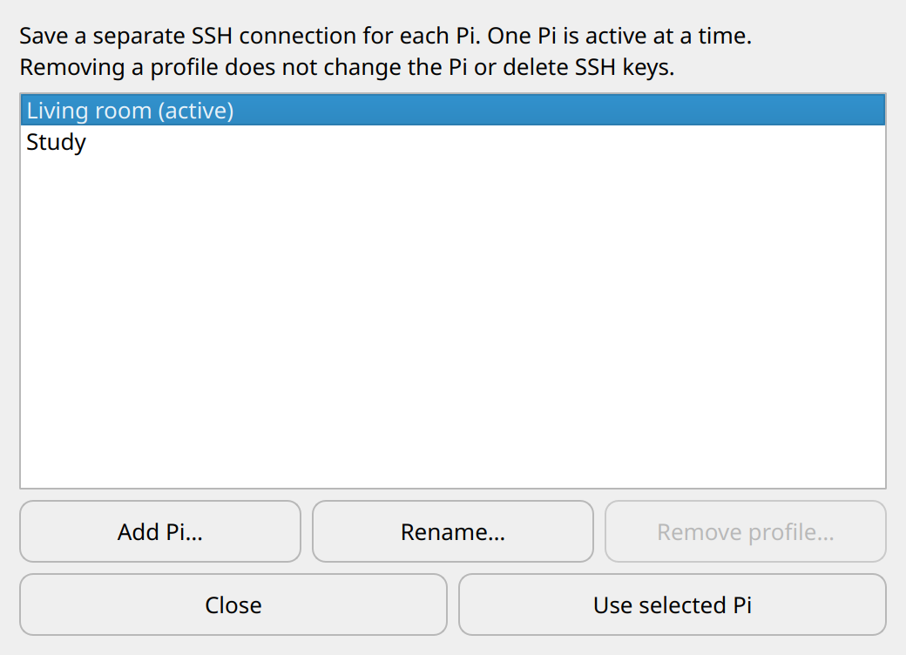
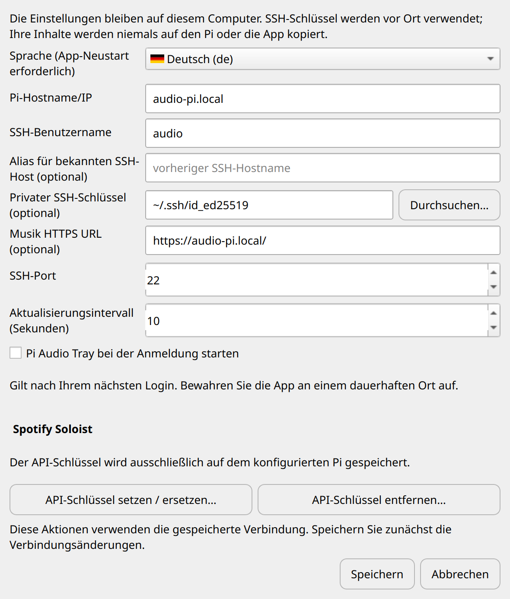
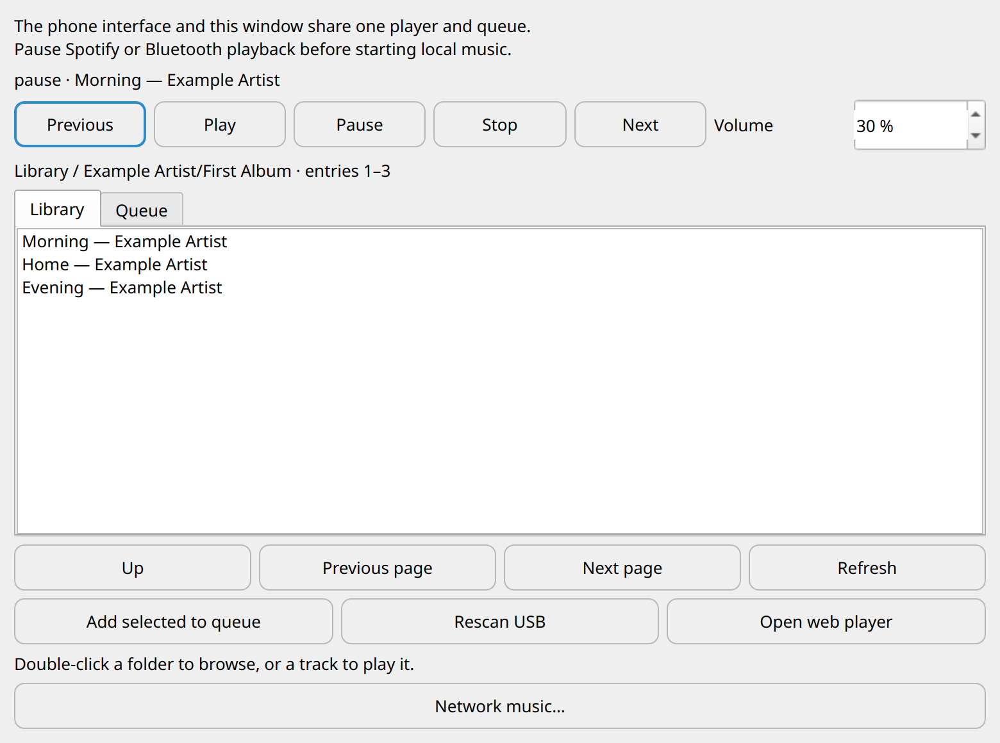
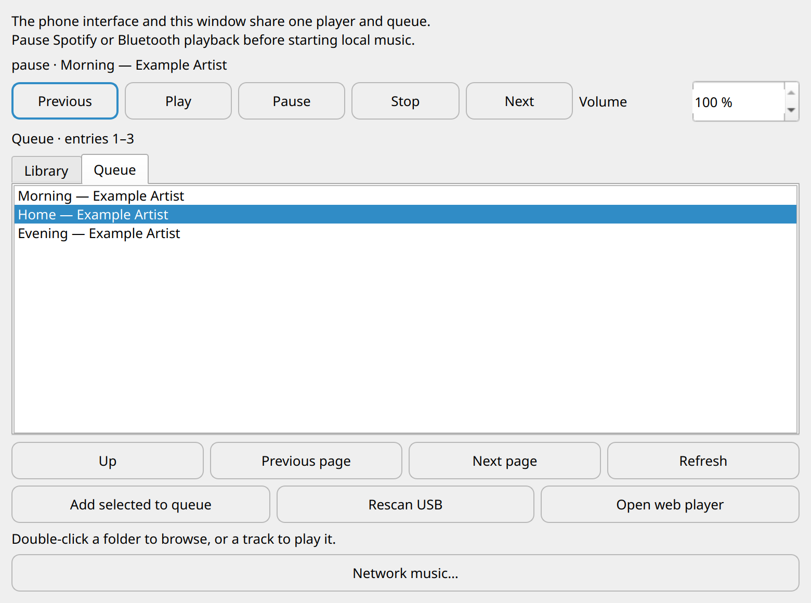
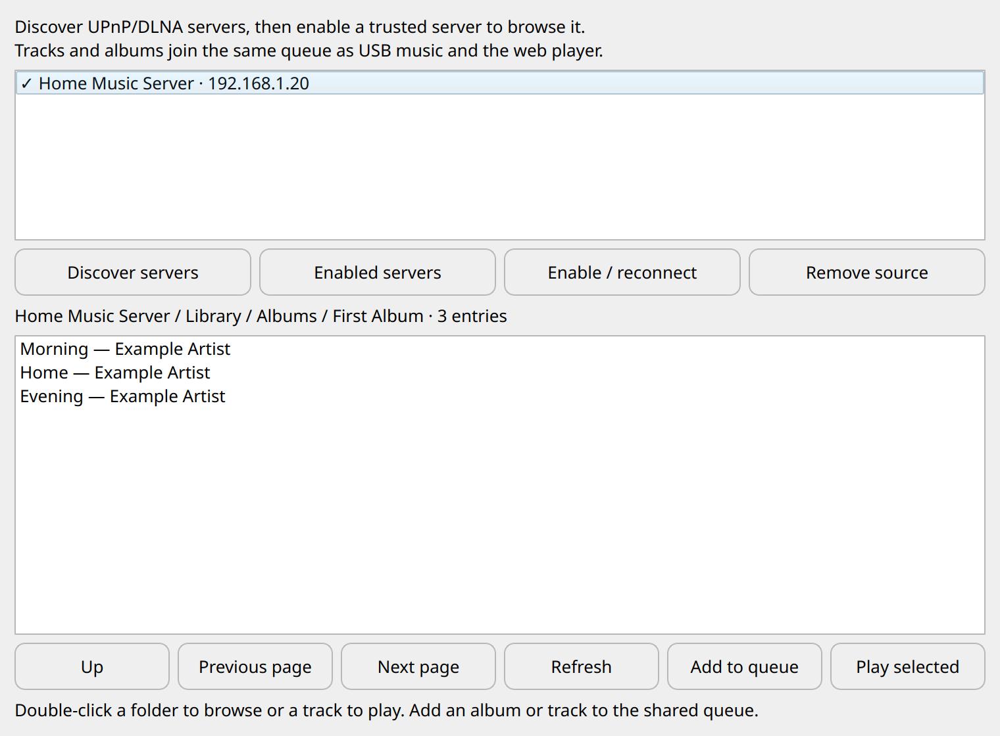
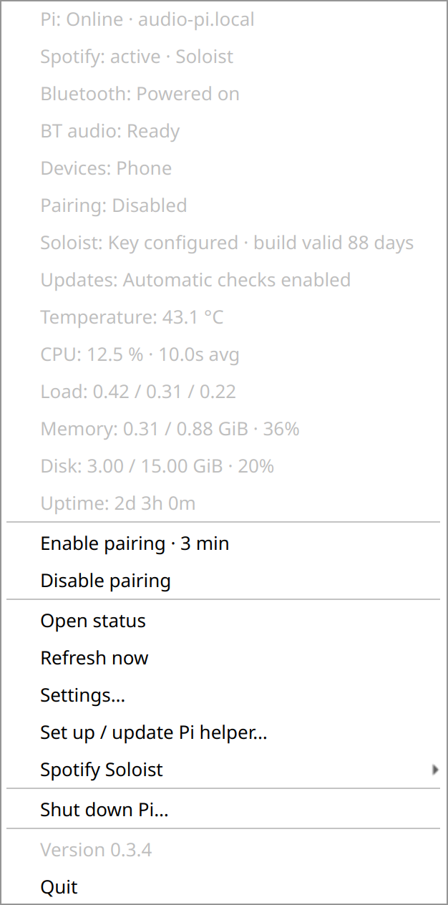
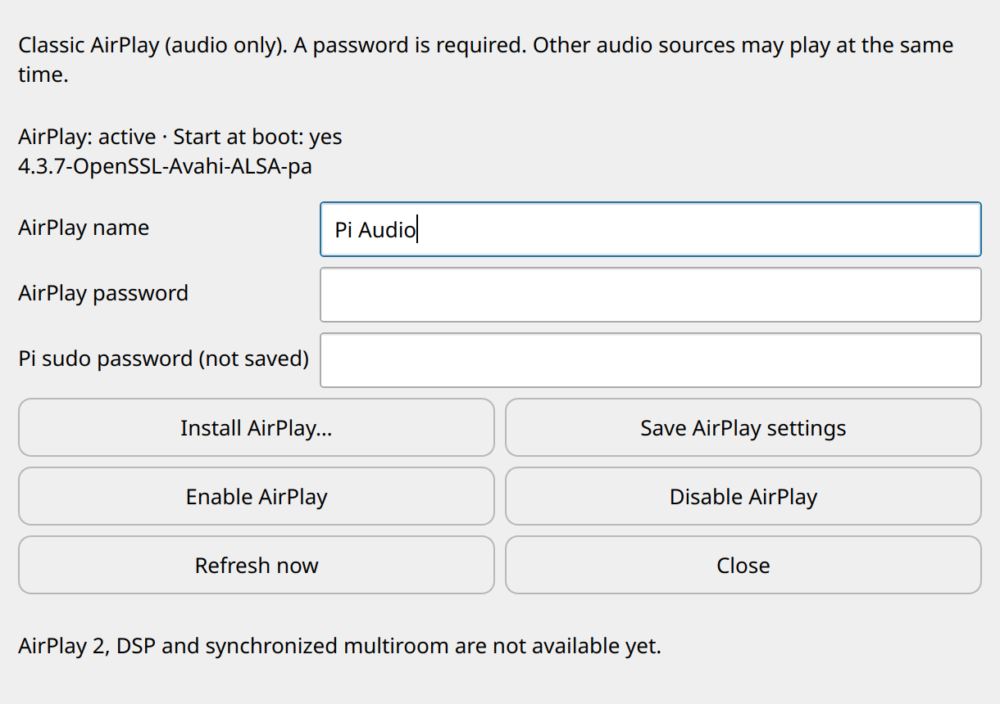
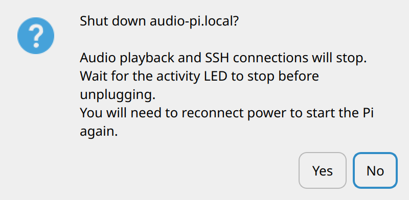

# Pi Audio Tray

A small Linux/Windows tray and macOS menu-bar app for a Raspberry Pi running Spotify
Soloist with PipeWire,
or the older Raspotify / BlueALSA setup.
Connect over SSH, monitor the receiver, and open or close Bluetooth pairing
without typing commands. There are no cloud services or telemetry.

The status window groups receiver services and system health into two cards, with
vector symbols and a small, non-animated status LED in the bottom corner. Hover
for the latest status or click for details; routine refreshes do not show a
central message or move the controls and rows. Colors follow the desktop palette with teal action accents.

**Status: experimental.** The combination below has been tested on real hardware.
Other distributions and boards have not been validated. This project is not
affiliated with Spotify or Raspberry Pi.

## Local music and phone playback control

The optional **Music…** window browses a Pi-attached library and controls its
MPD queue and volume. A mobile-friendly myMPD web player can share the same queue
over authenticated HTTPS, with a remembered browser login. HTTP port 80 can
redirect to standard HTTPS, avoiding an explicit port in the URL. Enable it in the
new-Pi wizard or follow the manual setup; see
[requirements, installation, certificate trust and security](docs/LOCAL_MUSIC.md).
The supplied installer targets Debian/Raspberry Pi OS 13 with PipeWire and a
FAT32 USB drive. Spotify/Bluetooth and local playback can mix; pause the previous
source when switching.

## Compatibility and requirements

| Component | Tested / required |
| --- | --- |
| Linux desktop tested | Ubuntu 26.04 x86_64, GNOME with the AppIndicator extension |
| Linux package | x86_64 AppImage; other Linux architectures are not packaged |
| macOS packages | Separate Apple Silicon (arm64) and Intel (x86_64) `.app.zip` builds, targeting macOS 15+; see [macOS notes](docs/MACOS.md) for validation and signing status |
| Windows package | x86_64 portable ZIP targeting Windows 11; native tests/build on Windows Server 2022 CI; see [Windows notes](docs/WINDOWS.md) for validation and signing limits |
| Receiver tested | Raspberry Pi 3 Model B+, 1 GB RAM, 64-bit Raspberry Pi OS / Debian 13 Trixie |
| Receiver audio output tested | Built-in 3.5 mm headphone output; other DACs/HDMI not tested |
| Recommended audio stack | Spotify Soloist ARM64, PipeWire 1.4, WirePlumber 0.5, BlueZ |
| Legacy backend | Raspotify / librespot with BlueALSA; Spotify can refuse audio keys even when the service is active |
| Network | SSH access to the Pi; Bluetooth devices must be in radio range; Spotify discovery requires the local network |
| SSH authentication | Existing private key or SSH agent; SSH password prompts are not supported |
| Pi permissions | Read-only status uses normal SSH; the fresh-Pi wizard accepts a one-time sudo password; runtime pairing uses exact sudo rules |
| Spotify | Each Soloist user needs their own API key; Spotify requires Premium to create it |
| Development | Python 3.12+, pinned dependencies in `requirements.txt`; AppImage builds additionally need squashfs-tools |

The AppImage bundles Python, Qt, and Paramiko, but still depends on the host's
Linux desktop/graphics libraries. Compatibility with older Ubuntu releases is
not established. Release packages are built and smoke-tested on Ubuntu 24.04;
interactive desktop use has been tested on the Ubuntu version listed above. Bluetooth audio after migration should be tested
on each deployment; service readiness alone does not prove audible playback.

Existing receivers can use **Update Pi helper…** or the
[manual upgrade instructions](docs/PI_SETUP.md#upgrading-an-existing-installation).
Updating the desktop package alone does not replace Pi-side maintenance scripts.
See the [security model and runtime permissions](SECURITY.md) before granting
administrative access.

### Which Raspberry Pis are supported?

**This is not a promise of support for every Raspberry Pi.** The running receiver
has been tested on a **Pi 3 Model B+, 1 GB RAM, 64-bit Debian/Raspberry Pi OS 13,
built-in headphone output**. The new-Pi installer itself still needs a complete
first-install test on spare hardware.

| Board / configuration | Current status |
| --- | --- |
| Pi 3 Model B+ with the tested configuration above | Existing receiver/audio deployment tested; fresh-install wizard remains preview |
| Other ARM64 Pis, including Pi 4 / 5 and keyboard / Compute Module variants | Candidates with the required OS, audio hardware and Bluetooth adapter; no model-wide validation or guarantee |
| Zero 2 W | 64-bit CPU, but only 512 MB RAM; the full web/Cockpit/update stack has not been validated on it |
| Any Pi running a 32-bit userspace (`armhf`) | Unsupported by this ARM64 installer/updater, even on a 64-bit-capable board; see the mixed-kernel caveat below |
| Pi 1 and original Zero / Zero W / Zero WH | 32-bit hardware; outside this installer's scope |
| Pi 2 | Revision-dependent hardware; no compatibility claim without validating the revision, OS and peripherals |
| Other Linux distributions, older/newer Debian versions, or non-Pi ARM boards | Outside the fresh-install wizard's current Debian/Pi OS 13 ARM64 target |

The architecture limit belongs to **this installer/updater**. Upstream
[Soloist also offers ARMv7 support](https://github.com/spotify/soloist#requirements);
that does not make our ARM64 setup work on 32-bit systems. Zero-family CPU and
memory specifications are in Raspberry Pi's [model documentation](https://www.raspberrypi.com/documentation/computers/zero.html).

Hardware and deployment caveats:

- **A 64-bit kernel is not enough.** Raspberry Pi OS can combine a 64-bit kernel
  with 32-bit userspace. Version **0.7.1 checks the package architecture and Python
  bitness too**, rejecting that unsupported combination. Our virtual image tests
  reproduced and fixed the incorrect acceptance in 0.7.0. Choose the actual
  **64-bit OS image**; `dpkg --print-architecture` must return **`arm64`**.
  Raspberry Pi documents this distinction in its [kernel guide](https://www.raspberrypi.com/documentation/computers/linux_kernel.html).
- **Audio output varies.** Pi 5 has no analogue headphone output; use suitable
  HDMI/USB audio or a configured DAC/HAT. The wizard selects an existing PipeWire
  sink; it does not configure HAT drivers, device-tree overlays or HDMI/EDID quirks.
  See Raspberry Pi's [audio options](https://pip-assets.raspberrypi.com/categories/1259-audio-camera-and-display/documents/RP-008124-WP/Choosing-an-Audio-option).
- **Bluetooth needs a working controller.** Boards/modules without an enabled
  radio need a compatible adapter before setup. The base setup always configures
  Bluetooth; it does not offer a Bluetooth-free install. Its profile receives
  audio **from a phone into the Pi**; Bluetooth-speaker output is not configured.
- **Resources and power need checking.** 1 GB RAM is the tested configuration,
  not a measured minimum. Available storage, large MPD libraries, package updates,
  USB power needs and cooling depend on the board and selected components.
- **Discovery and HTTPS depend on the network/client.** Guest isolation, VLANs,
  multicast filtering, firewalls, VPNs or missing `.local` resolution can prevent
  discovery/access. Trust the generated CA on each browser/phone separately.
- **The check is not a hardware certification.** It checks OS, architecture,
  account and conflicting setup, and lists USB devices. It does not prove radio,
  DAC, memory capacity, thermal stability or audible playback. Test Spotify,
  Bluetooth, MPD and reboot persistence on each new deployment.

## Set up a new Pi (0.7.4 preview)

The wizard is available in the **[0.7.4 preview release](https://github.com/richterrene/pi-audio-tray/releases/tag/v0.7.4)**
for Linux, Windows and both Mac architectures. GitHub's latest stable release
may be older and lack the wizard. **A complete installation on a spare blank Pi
has not yet been tested.** Automated installer fixtures and native desktop
build/smoke checks pass; they do not establish working audio on every board.

1. Flash **Raspberry Pi OS Lite / Debian 13 Trixie, 64-bit ARM64**. Configure
   networking, a normal administrator account and SSH public-key access, then
   boot the Pi. Flashing the card and initial network setup happen outside the app.
2. In tray **Settings**, enter the Pi host, SSH username and private-key filename
   or use your SSH agent. Verify the Pi's SSH fingerprint independently when
   prompted. SSH login passwords are unsupported; the later **sudo password**
   prompt is separate. The Pi needs internet access to install packages.
3. Choose **Set up a new Pi… → Check Pi**, select components, and enter the Pi
   DNS name used for its web certificate. Review Spotify's Soloist terms and
   confirm the download choice.
4. Enter the Pi user's sudo password in the masked field, choose **Review and
   install…**, and confirm the plan. The password is sent over verified SSH and
   is not saved. Keep the connection and app open until installation completes.
5. Finish with **Refresh audio outputs → Use output** and **Set Soloist API key…**.
   Supply your own key from Spotify; no personal keys or existing Pi credentials
   are bundled. Lower your amplifier before the first playback test: MPD and
   Soloist player defaults are 100%, while hardware/master volume stays unchanged.

The base installs **Soloist, PipeWire/WirePlumber, BlueZ Bluetooth receiving,
Avahi and monitoring/pairing helpers**. Audio starts at boot without an SSH
session; Bluetooth pairing/discovery starts disabled. Soloist updates are
enabled daily even if system updates are deselected.

| Component | Default | What it configures |
| --- | --- | --- |
| System updates | On | Trixie package updates around 03:00 and a conditional 05:30 reboot, in the **Pi's local timezone**; maintenance timers are armed after setup verifies |
| Process privacy | On | Persistent `hidepid=2` to hide other accounts' process details, including Soloist key arguments; root and the audio account retain access |
| Tray shutdown | On | Exact sudo permission for graceful Pi poweroff |
| MPD / USB / UPnP | Off | Read-only USB library, shared playback queue and desktop UPnP browsing; MPD uses a private Unix socket |
| HTTPS phone player | Off | Requires MPD; remembered cookie login on HTTPS 443/8443, HTTP 80 redirect, a local CA and automatic certificate renewal |
| Cockpit management | Off | Loopback-only `127.0.0.1:9090`; connect through an SSH tunnel, not a public management port |

MPD setup currently needs a **FAT32 USB filesystem containing a `Music/`
directory**. Other filesystems and UPnP-only/MPD-without-USB setup are not offered
by this first wizard. No storage is formatted. Existing receiver installations
and custom audio configurations are refused; Raspotify/BlueALSA migration is manual.

The web player gets a **new random password** for username `music`. Retrieve
`~/.config/pi-audio-tray/music-web-login.txt` and the public `music-ca.crt` over
verified SSH/SFTP, then follow the [certificate trust instructions](docs/LOCAL_MUSIC.md#https-and-login)
on each computer or phone. CA import is not automatic; never copy its private key.
Cockpit uses the Pi account credentials and needs an SSH tunnel; the tray does
not yet manage that tunnel or create a Cockpit password.

Installation is **not transactional**: completed changes remain after a failure.
An incomplete run can be retried with the identical plan after an administrator
checks the root-private log/state; completed installations cannot be overwritten.
The wizard validates narrow runtime sudo rules but does not remove any broader
sudo privileges already granted by the OS. See the
[complete setup and recovery guide](docs/NEW_PI_SETUP.md) and
[setup security review](docs/SETUP_REVIEW_2026-10-27.md).

## Features

The next source revision adds optional **classic AirPlay** under
**Maintenance → Audio integrations…**: install on an existing supported receiver,
set an AirPlay name/password, then enable. It uses the existing PipeWire output
and can be disabled independently. It is not in the 0.7.4 packages and awaits physical Apple-device
validation. AirPlay 2, system-wide DSP and synchronized multiroom are planned,
not available features; see the [audio roadmap and setup/security details](docs/AUDIO_ROADMAP.md).

- Fresh-Pi setup wizard with optional music/web services and Cockpit; [preview limits](docs/NEW_PI_SETUP.md).
- Pi reachability, Soloist/Raspotify service state, Bluetooth power, audio services,
  connected device names, and pairing state.
- Pi temperature, aggregate CPU usage, 1/5/15-minute load, memory, root-disk use,
  and uptime in both the status window and tray menu. Missing sensors show Unavailable.
- Confirmed graceful Pi shutdown from the tray, with an optional exact sudo rule.
  Known scheduled updates block the request; starting again requires reconnecting power.
- Three-minute pairing window with confirmation dialogs on the desktop.
- Pairing closes on timeout, normal app exit, or SSH channel closure. BlueZ's
  own pairing/discovery timeouts also limit the window if the helper crashes.
- Devices explicitly approved by the user are trusted when pairing completes
  and the session closes. Existing trusted connections survive pairing off.
- Configurable host, port, SSH username, private-key filename, known-host alias,
  and polling interval. Settings are stored locally, outside the application.
- AppImage includes the GUI, Python, and SSH libraries. No Python installation
  or tray library package is needed on the desktop.
- Soloist API key entry, replacement, and removal without storing a local copy.
  Key files on the Pi are private (directory mode 700, file mode 600).
- Soloist build lifetime and automatic update status, including failed update runs.

Only the visible, non-minimized status window refreshes system statistics at the
configured interval. The compact tray menu shows Pi, Spotify, Bluetooth and
pairing health, with maintenance and profile choices grouped into submenus.
Opening the menu requests a fresh **health-only** snapshot; it does not enable
CPU, temperature, load, RAM, disk or uptime polling. With the status window hidden,
regular health checks run once a minute (or less often if your interval is longer).
Opening the status window requests detailed statistics immediately; a prior
cached value can remain briefly while that request completes. A detailed request
already in progress can finish after hiding the window. Pairing events and
explicit operations can trigger additional health checks. Qt-rendered menus are
bounded to the active monitor work area and can scroll; native exported menus
retain OS rendering. Version 0.3.3+ requires the Pi helper's `health` action.

CPU usage is averaged across all cores between refreshes (a one-second sample
on the first refresh or after a cache reset); the displayed window shows the
actual averaging interval. One fully busy core on a four-core Pi is about 25%.
A quiet Pi can correctly show 0.0%. Load averages are Linux runnable/uninterruptible
task counts, not percentages.
Memory use subtracts MemAvailable (including reclaimable cache), and disk use
covers the root filesystem only. Only the previous CPU counters are cached
privately on the Pi; no historical time series is stored.

Spotify status is the **service status**, not currently playing tracks. Bluetooth
device status indicates a connection, not proof of current audio playback.

## Multiple Pis and interface language

Use **Manage Pis…** to add, rename or remove named connections, then choose an
**Active Pi** in the window or **Switch Pi** in the tray menu. Each profile keeps
its own SSH connection and web-player URL. Existing settings become **My Pi**.
Only one Pi is monitored at a time; switching leaves its playback running and is
blocked during pairing or another operation. See [Pi profiles](docs/PI_PROFILES.md)
for host-key verification, migration, storage and recovery details.

In **Settings**, choose a language by its national flag and native name, then
**Save**. Quit and reopen the tray app to apply it; no Pi reboot is needed.
The initial set includes English, German, French, Spanish, Italian, Portuguese,
Dutch, Polish, Czech, Romanian, Hungarian, Greek, Swedish, Danish, Norwegian
Bokmål, Finnish, Ukrainian, Turkish and Russian. Initial translations are
machine-assisted and welcome native-speaker corrections. Remote technical
errors may remain English; myMPD's web interface manages its own language.
[Translation files and contribution instructions](docs/TRANSLATIONS.md) explain
how to add a language without changing the app's language registry.

## Start automatically at login

In **Settings…**, enable **Start Pi Audio Tray when I sign in** and click
**Save**. Turn it off and save to disable the registration. Linux keeps a small disabled
override if needed to mask a system-wide entry. It is off by default,
starts in the tray/menu bar, and applies to the current desktop account after
its next login, rather than running a system service before login. If a system
tray is unavailable, the status window opens instead.

No administrator rights are required. Linux uses
`$XDG_CONFIG_HOME/autostart/pi-audio-tray.desktop` (normally
`~/.config/autostart/`); macOS uses
`~/Library/LaunchAgents/org.piaudiotray.desktop.plist`; Windows uses the
`Pi Audio Tray` value under `HKCU\Software\Microsoft\Windows\CurrentVersion\Run`.
Operating-system startup/background-item controls may additionally block launch.
The checkbox reports the app registration, not those external overrides.

Keep the AppImage or fully extracted Windows folder in a permanent location.
On macOS, move the app into Applications and reopen it first; temporary
App Translocation and mounted-volume paths are rejected. After moving or
updating a versioned package, open the new version manually to refresh an
existing enabled registration, or enable it again in Settings. Removing the
registration does not stop a currently running app. The registration contains
local executable paths only, with no SSH credentials or Pi settings.

## Screenshots

These screenshots show the current desktop UI (0.7.4), rendered from the actual
Linux/Qt widgets with **fictional demo connection details and music metadata**. No real
account, device address, SSH key, or Soloist API key is shown. macOS uses its
native window and menu-bar presentation. Windows uses its system tray; see the
platform notes for native validation limits.

### New Pi setup (preview)



This demo selects the optional components; their actual defaults are listed
above. See the [setup guide](docs/NEW_PI_SETUP.md) before provisioning a fresh receiver.

### Receiver status


### Connection and Soloist key settings


### Pi profiles and language selection





### Music library



### Shared playback queue



### UPnP network music



### Tray menu



### Optional audio integrations



### Shutdown confirmation



Regenerate these screenshots from the actual widgets using
`python tools/generate_screenshots.py`; the script uses a temporary config
directory and does not connect to a receiver. The separate browser sign-in page
belongs to the optional Pi web player; its screenshot is in the
[web-player documentation](docs/LOCAL_MUSIC.md#https-and-login).

## Shutting down the receiver

Open the tray menu and choose **Shut down Pi…**. Check the hostname in the
confirmation, then choose **Yes**. The default is **No**. Pairing or another Pi
operation must finish first; the app also checks the known scheduled update
services. Audio and SSH will stop. Wait for the Pi’s activity LED to settle before
unplugging, and reconnect power to start it again. A submitted request or lost
SSH connection does not prove that shutdown has completed.

The action needs the [optional exact sudo rule](docs/PI_SETUP.md#optional-tray-shutdown)
on the Pi. Updating the desktop alone does not grant that permission. **Quit**
closes only the tray application; **Shut down Pi…** powers off the receiver.

## Run

### Linux

For the setup wizard, download the x86_64 AppImage from the
[0.7.4 preview release](https://github.com/richterrene/pi-audio-tray/releases/tag/v0.7.4),
make it executable, and launch it:

```sh
chmod +x PiAudioTray-0.7.4-x86_64.AppImage
./PiAudioTray-0.7.4-x86_64.AppImage --show
```

Ubuntu's AppIndicator extension must be enabled for the tray icon. When no tray
is available, the status window remains usable. The build depends on normal
Linux desktop libraries (glibc, D-Bus, graphics); AppImage does not bundle a whole
operating system. Builds are tested on the build host; cross-distro portability
must be checked before claiming support for additional distributions.

Open **Settings** and enter your Pi connection. Keys stay in their original
location. Use an SSH agent for passphrase-protected keys; this app does not save
passwords or passphrases. If you connect through a different hostname from the
one already in `~/.ssh/known_hosts`, enter the old name in **Known-host alias**.
Unknown host keys require explicit fingerprint approval; changed keys are rejected.

### Windows

Download and fully extract `PiAudioTray-0.7.4-Windows-x86_64.zip` from the
[preview release](https://github.com/richterrene/pi-audio-tray/releases/tag/v0.7.4), then run
**Pi Audio Tray.exe** inside the extracted folder. Keep `_internal` beside it.
No Python installation is needed. The build is unsigned; see [Windows setup and
security](docs/WINDOWS.md). Receiver configuration and shutdown/pairing permissions
are the same as on Linux/macOS.

### macOS

Download the ZIP matching your Mac's architecture from the
[preview release](https://github.com/richterrene/pi-audio-tray/releases/tag/v0.7.4),
extract it, and drag **Pi Audio
Tray.app** into Applications. The app lives in the menu bar; **Open status** shows
its window. Initial builds are ad-hoc signed, **not Developer ID signed or
notarized**. See [macOS setup and signing](docs/MACOS.md) before downloading.
The Pi configuration and SSH permissions are the same as on Linux.

### Existing receivers

**Update Pi helper…** retains the older helper-only installation path for already
configured receivers. It requires existing administrative noninteractive sudo;
the narrow runtime rules do not permit helper replacement. It does not migrate
Raspotify/BlueALSA, reinstall the audio stack or grant additional sudo permissions.

## Spotify Soloist

Download Soloist directly from [Spotify's official downloads](https://developer.spotify.com/documentation/soloist/reference/downloads-and-updates).
The app and repository do not include or redistribute Spotify's executable.
Soloist requires PipeWire or PulseAudio on the Pi. `pi/soloist.service` and
`pi/50-audio-receiver.conf` provide a user-service and headless PipeWire example.
Enable lingering for that user so audio services start at boot without SSH.
Avoid running BlueALSA and PipeWire Bluetooth monitors simultaneously.

Generate a personal API key at the [Soloist dashboard](https://developer.spotify.com/dashboard/soloist).
In **Settings → Spotify Soloist** or the tray submenu, choose **Set / replace API key**. The masked
dialog sends it over SSH straight to `~/.config/soloist/api-key` on the Pi.
The desktop app does not save the key locally. **Remove API key** stops Soloist
and deletes that file; revocation at Spotify remains a separate dashboard action.
The root-owned launcher reads the private file at startup, rather than putting
the secret into a service unit or this repository.

The **90-day lifetime applies to client builds, not API keys**. The optional
`soloist-update` service downloads ARM64 builds directly from Spotify, checks
bounded archive contents and the ARM64 executable header, and atomically
replaces it only when changed. It never runs downloaded code as root. Redirects
stay on Spotify’s official HTTPS download host, and the systemd service limits
filesystem access and resources. There is no separate vendor signature check. The previous executable
is retained as `/usr/local/bin/soloist.previous`. Keys and session data are preserved.
The updater reads the local service account name from `/etc/pi-audio-tray/soloist-user`.
It requires root ownership for its script and configuration. The daily timer runs
between 04:00 and 06:00 local time, with catch-up after downtime. The tray action
**Check for updates now** runs the same service. Updates can briefly interrupt audio.

## Optional automatic system updates

The example APT configuration in `pi/52pi-audio-upgrades` allows updates within
Debian/Raspberry Pi OS Trixie, plus the already configured Raspotify repository.
It does not switch to a new distribution release. Review the origins if using
a different OS version. `apt-daily-timer.conf` refreshes package lists at
02:30–02:45; `apt-upgrade-timer.conf` installs updates at 03:00–03:15.
The optional needrestart configuration restarts affected services after upgrades.

`pi-audio-reboot.timer` checks at **05:30 local time**. It reboots only if the
standard reboot marker is present or needrestart reports an outdated kernel.
Unknown kernel status does not trigger a reboot. If an update is still running,
the reboot is deferred until the next day. Missed reboot times are not caught up
during daytime. Test detection without rebooting using:

```sh
sudo /usr/local/lib/pi-audio-tray/reboot-if-needed --check-only
sudo unattended-upgrade --dry-run --debug
systemctl list-timers apt-daily.timer apt-daily-upgrade.timer soloist-update.timer pi-audio-reboot.timer
```

The supplied Soloist unit disables the unauthenticated WebSocket control server.
Consequently, `soloist ctl` commands requiring that server are unavailable by
default; playback is controlled through Spotify Connect.

Logs are available with `journalctl -u soloist-update.service` and under
`/var/log/unattended-upgrades/`.

If preferred, install manually on the Pi:

```sh
sudo apt install python3-dbus python3-gi
sudo install -d -m 755 /usr/local/lib/pi-audio-tray
sudo install -o root -g root -m 755 pi_helper.py /usr/local/lib/pi-audio-tray/pi-helper
```

Choose **Enable pairing**, pair from your phone/computer, and approve the request
only if it is your device. **Disable pairing** closes the window immediately.
New incoming requests may appear during that window, but are not auto-approved.
Legacy devices requiring PIN entry are currently unsupported.

## Local data and privacy

Configuration and app-approved host keys are stored in
`$XDG_CONFIG_HOME/pi-audio-tray` (normally `~/.config/pi-audio-tray` on Linux).
On Windows the default is `%APPDATA%\Pi Audio Tray`, protected using native
Windows ACLs rather than POSIX modes. On macOS the default is `~/Library/Application Support/Pi Audio Tray`. That directory
is not in the repository or AppImage. SSH private keys stay on the desktop.
The Soloist API key is deliberately sent to the Pi over SSH and stored there;
it is never included in Git or AppImage builds. Connected device names and addresses
are shown at runtime only. The app does not write a persistent log itself; launchers may redirect its
output. That output can contain hostnames and errors, so redact it before sharing.

Builds copy source into a neutral temporary path to avoid embedding local account
names in compiled Python paths. Build artifacts, keys, local configuration, and
virtual environments are excluded from Git. Do not commit your settings or runtime
screenshots if you intend to keep device names private.

## Develop and test

See [CONTRIBUTING.md](CONTRIBUTING.md) for a first PR, test environments, screenshots
and CI, and [the architecture map](docs/ARCHITECTURE.md) for module boundaries.
The [2026-10-28 review](docs/CODE_REVIEW_2026-10-28.md) records edge-case fixes and
remaining collaboration/validation limits.


```sh
python3 -m venv .venv
. .venv/bin/activate
python -m pip install --upgrade pip==26.2.0
pip install -r requirements.txt
python -m unittest discover -s tests -v
python app.py --show
```

## Build AppImage

On x86_64 Linux with `mksquashfs` installed, from the activated environment:

```sh
python build_appimage.py
```

The build downloads a versioned official AppImage runtime and verifies its pinned
SHA-256 checksum. Output and checksum are placed in `dist/`. Qt shared libraries
and third-party notices can be inspected with `--appimage-extract`.

The active `.github/workflows/desktop-builds.yml` workflow builds Linux on Ubuntu
24.04, macOS on Apple Silicon and Intel macOS 15 runners, and Windows x64 on
Windows Server 2022. Pull requests run its native tests on all four targets; package creation is
skipped for PRs. Full builds can be dispatched manually or triggered by a version tag. It uploads artifacts, not public releases,
and does not change repository visibility. Mac builds require native macOS tools;
run `python build_macos.py` on the desired architecture. See the macOS notes.


## Build Windows

Run `python build_windows.py` on native Windows x64. It creates a portable ZIP,
checks the executable architecture, and runs a frozen GUI/private-storage smoke
test. See [Windows prerequisites and limits](docs/WINDOWS.md#building).

### Network music (UPnP / DLNA)

Use **Music… → Network music…** to discover and enable home media servers, browse
albums, and add tracks to the same queue as USB music. Source browsing is on the
desktop; queued tracks also appear in the phone web player. The server must stay
awake. No music copy or Samba mount is needed. Requires the matching updated Pi
music helper. See [compatibility and setup](docs/LOCAL_MUSIC.md#upnp--dlna-music-servers-06).

## Virtual Pi image tests

An optional [local QEMU lab](docs/VIRTUAL_TESTS.md) boots checksum-pinned official
Pi OS Lite images in disposable disks, without physical hardware. It runs the
normal-user setup probe and 35 Pi-side regression tests per image, including real
Unix-socket web-login tests. The matrix covers ARM64 and mixed 64-bit-kernel /
32-bit-userspace configurations; the latter must be rejected.

```sh
python3 tools/virtual/run.py --build
```

This requires Linux, existing Docker access and roughly 15–20 GB of cache space.
The runner uses no privileged containers, host devices, network or real Pi
credentials. **It does not run the full installer, normal systemd boot, Spotify
authentication or physical audio/Bluetooth tests.** These checks improve software
coverage; they do not certify every Pi model or replace a blank-Pi installation
test. See the guide for the measured results and emulator limitations.
