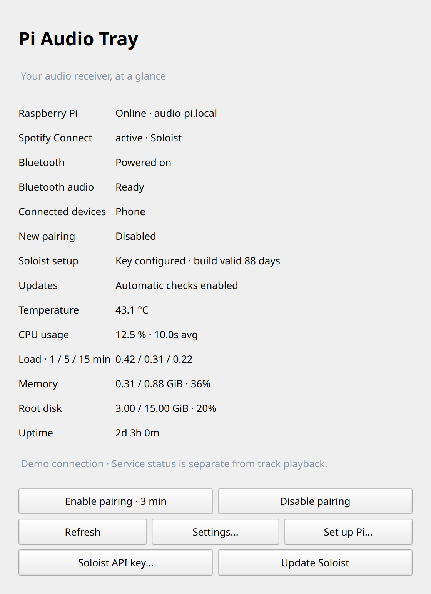
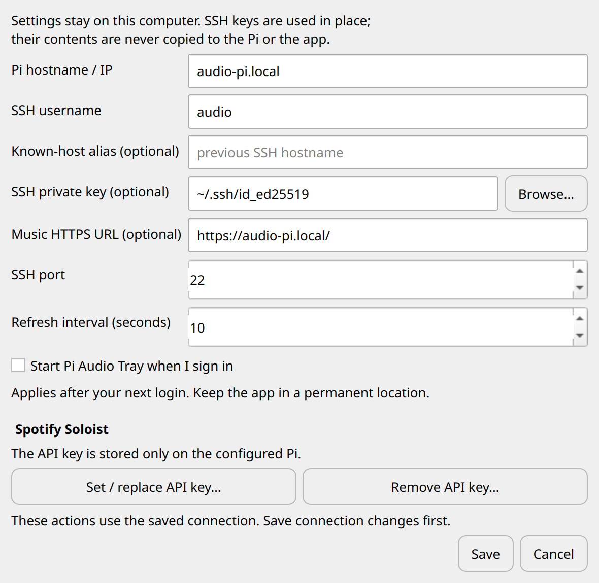

# Pi Audio Tray

A small Linux tray app for a Raspberry Pi running Spotify Soloist with PipeWire,
or the older Raspotify / BlueALSA setup.
Connect over SSH, monitor the receiver, and open or close Bluetooth pairing
without typing commands. There are no cloud services or telemetry.

**Status: experimental.** The combination below has been tested on real hardware.
Other distributions and boards have not been validated. This project is not
affiliated with Spotify or Raspberry Pi.

## Compatibility and requirements

| Component | Tested / required |
| --- | --- |
| Linux desktop tested | Ubuntu 26.04 x86_64, GNOME with the AppIndicator extension |
| Linux package | x86_64 AppImage; other Linux architectures are not packaged |
| macOS packages | Separate Apple Silicon (arm64) and Intel (x86_64) `.app.zip` builds, targeting macOS 15+; see [macOS notes](docs/MACOS.md) for validation and signing status |
| Windows | Not supported |
| Receiver tested | Raspberry Pi 3 Model B+, 1 GB RAM, 64-bit Raspberry Pi OS / Debian 13 Trixie |
| Receiver audio output tested | Built-in 3.5 mm headphone output; other DACs/HDMI not tested |
| Recommended audio stack | Spotify Soloist ARM64, PipeWire 1.4, WirePlumber 0.5, BlueZ |
| Legacy backend | Raspotify / librespot with BlueALSA; Spotify can refuse audio keys even when the service is active |
| Network | SSH access to the Pi; Bluetooth devices must be in radio range; Spotify discovery requires the local network |
| SSH authentication | Existing private key or SSH agent; SSH password prompts are not supported |
| Pi permissions | Read-only status uses normal SSH; setup and pairing require noninteractive sudo for the documented helper commands |
| Spotify | Each Soloist user needs their own API key; Spotify requires Premium to create it |
| Development | Python 3.12+, pinned dependencies in `requirements.txt`; AppImage builds additionally need squashfs-tools |

The AppImage bundles Python, Qt, and Paramiko, but still depends on the host's
Linux desktop/graphics libraries. Compatibility with older Ubuntu releases is
not established. The CI template uses Ubuntu 24.04; a template alone is not a
successful compatibility test. Bluetooth audio after migration should be tested
on each deployment; service readiness alone does not prove audible playback.

For a new receiver, follow [Pi setup](docs/PI_SETUP.md) before using the tray.
The app's **Set up / update Pi helper** installs the status/pairing helper only;
it does not install the complete audio stack. [Security model, permissions, incident recovery and audit checks](SECURITY.md)
explain key handling and privileged operations. Existing installations should
follow the [0.3 upgrade steps](docs/PI_SETUP.md#upgrading-an-existing-installation);
updating the desktop package alone does not replace Pi-side maintenance scripts.

## Features

- Pi reachability, Soloist/Raspotify service state, Bluetooth power, audio services,
  connected device names, and pairing state.
- Pi temperature, aggregate CPU usage, 1/5/15-minute load, memory, root-disk use,
  and uptime in both the status window and tray menu. Missing sensors show N/A.
- Three-minute pairing window with confirmation dialogs on the desktop.
- Pairing closes on timeout, normal app exit, or SSH channel closure. BlueZ's
  own pairing/discovery timeouts also limit the window if the helper crashes.
- Devices explicitly approved by the user are trusted when pairing completes
  and the session closes. Existing trusted connections survive pairing off.
- Configurable host, port, SSH username, private-key filename, known-host alias,
  and polling interval. Settings are stored locally, outside the application.
- AppImage includes the GUI, Python, and SSH libraries. No Python installation
  or tray library package is needed on the desktop.
- Soloist API key entry, replacement, and removal without storing a local copy.
  Key files on the Pi are private (directory mode 700, file mode 600).
- Soloist build lifetime and automatic update status, including failed update runs.

CPU usage is averaged across all cores between refreshes (a one-second sample
on the first refresh or after a cache reset); the displayed window shows the
actual averaging interval. One fully busy core on a four-core Pi is about 25%.
A quiet Pi can correctly show 0.0%. Load averages are Linux runnable/uninterruptible task counts, not percentages.
Memory use subtracts MemAvailable (including reclaimable cache), and disk use
covers the root filesystem only. Only the previous CPU counters are cached privately on the Pi; no historical
time series is stored.

Spotify status is the **service status**, not currently playing tracks. Bluetooth
device status indicates a connection, not proof of current audio playback.

## Screenshots

The Linux/Qt interface below uses **fictional demo connection details**. No real
account, device address, SSH key, or Soloist API key is shown. macOS uses its
native window and menu-bar presentation.

### Receiver status



### Connection and Soloist key settings



Regenerate these screenshots from the actual widgets using
`python tools/generate_screenshots.py`; the script uses a temporary config
directory and does not connect to a receiver.

## Run

### Linux

Download the x86_64 AppImage, make it executable, and launch it:

```sh
chmod +x PiAudioTray-0.3.1-x86_64.AppImage
./PiAudioTray-0.3.1-x86_64.AppImage --show
```

Ubuntu's AppIndicator extension must be enabled for the tray icon. When no tray
is available, the status window remains usable. The build depends on normal
Linux desktop libraries (glibc, D-Bus, graphics); AppImage does not bundle a whole
operating system. Builds are tested on the build host; cross-distro portability
must be checked before claiming support for additional distributions.

Open **Settings** and enter your Pi connection. Keys stay in their original
location. Use an SSH agent for passphrase-protected keys; this app does not save
passwords or passphrases. If you connect through a different hostname from the
one already in `~/.ssh/known_hosts`, enter the old name in **Known-host alias**.
Unknown host keys require explicit fingerprint approval; changed keys are rejected.

### macOS

Download the ZIP matching your Mac's architecture, extract it, and drag **Pi Audio
Tray.app** into Applications. The app lives in the menu bar; **Open status** shows
its window. Initial builds are ad-hoc signed, **not Developer ID signed or
notarized**. See [macOS setup and signing](docs/MACOS.md) before downloading.
The Pi configuration and SSH permissions are the same as on Linux.

Choose **Set up / update Pi helper** once. This installs `python3-dbus` and
`python3-gi` from the Pi's apt repositories and a root-owned helper under
`/usr/local/lib/pi-audio-tray/pi-helper`. The SSH account needs passwordless sudo
for setup and pairing. No new sudo permissions are granted by this app.
Raspberry Pi OS / Debian with BlueZ and one of the supported audio stacks already
configured is required. This app does not silently migrate the underlying audio
routing. The optional Pi-side service/configuration sources are in `pi/`.

## Spotify Soloist

Download Soloist directly from [Spotify's official downloads](https://developer.spotify.com/documentation/soloist/reference/downloads-and-updates).
The app and repository do not include or redistribute Spotify's executable.
Soloist requires PipeWire or PulseAudio on the Pi. `pi/soloist.service` and
`pi/50-audio-receiver.conf` provide a user-service and headless PipeWire example.
Enable lingering for that user so audio services start at boot without SSH.
Avoid running BlueALSA and PipeWire Bluetooth monitors simultaneously.

Generate a personal API key at the [Soloist dashboard](https://developer.spotify.com/dashboard/soloist).
In **Settings → Spotify Soloist** or the tray submenu, choose **Set / replace API key**. The masked
dialog sends it over SSH straight to `~/.config/soloist/api-key` on the Pi.
The desktop app does not save the key locally. **Remove API key** stops Soloist
and deletes that file; revocation at Spotify remains a separate dashboard action.
The root-owned launcher reads the private file at startup, rather than putting
the secret into a service unit or this repository.

The **90-day lifetime applies to client builds, not API keys**. The optional
`soloist-update` service downloads ARM64 builds directly from Spotify, checks
bounded archive contents and the ARM64 executable header, and atomically
replaces it only when changed. It never runs downloaded code as root. Redirects
stay on Spotify’s official HTTPS download host, and the systemd service limits
filesystem access and resources. There is no separate vendor signature check. The previous executable
is retained as `/usr/local/bin/soloist.previous`. Keys and session data are preserved.
The updater reads the local service account name from `/etc/pi-audio-tray/soloist-user`.
It requires root ownership for its script and configuration. The daily timer runs
between 04:00 and 06:00 local time, with catch-up after downtime. The tray action
**Check for updates now** runs the same service. Updates can briefly interrupt audio.

## Optional automatic system updates

The example APT configuration in `pi/52pi-audio-upgrades` allows updates within
Debian/Raspberry Pi OS Trixie, plus the already configured Raspotify repository.
It does not switch to a new distribution release. Review the origins if using
a different OS version. `apt-daily-timer.conf` refreshes package lists at
02:30–02:45; `apt-upgrade-timer.conf` installs updates at 03:00–03:15.
The optional needrestart configuration restarts affected services after upgrades.

`pi-audio-reboot.timer` checks at **05:30 local time**. It reboots only if the
standard reboot marker is present or needrestart reports an outdated kernel.
Unknown kernel status does not trigger a reboot. If an update is still running,
the reboot is deferred until the next day. Missed reboot times are not caught up
during daytime. Test detection without rebooting using:

```sh
sudo /usr/local/lib/pi-audio-tray/reboot-if-needed --check-only
sudo unattended-upgrade --dry-run --debug
systemctl list-timers apt-daily.timer apt-daily-upgrade.timer soloist-update.timer pi-audio-reboot.timer
```

The supplied Soloist unit disables the unauthenticated WebSocket control server.
Consequently, `soloist ctl` commands requiring that server are unavailable by
default; playback is controlled through Spotify Connect.

Logs are available with `journalctl -u soloist-update.service` and under
`/var/log/unattended-upgrades/`.

If preferred, install manually on the Pi:

```sh
sudo apt install python3-dbus python3-gi
sudo install -d -m 755 /usr/local/lib/pi-audio-tray
sudo install -o root -g root -m 755 pi_helper.py /usr/local/lib/pi-audio-tray/pi-helper
```

Choose **Enable pairing**, pair from your phone/computer, and approve the request
only if it is your device. **Disable pairing** closes the window immediately.
New incoming requests may appear during that window, but are not auto-approved.
Legacy devices requiring PIN entry are currently unsupported.

## Local data and privacy

Configuration and app-approved host keys are stored in
`$XDG_CONFIG_HOME/pi-audio-tray` (normally `~/.config/pi-audio-tray` on Linux).
On macOS the default is `~/Library/Application Support/Pi Audio Tray`. That directory
is not in the repository or AppImage. SSH private keys stay on the desktop.
The Soloist API key is deliberately sent to the Pi over SSH and stored there;
it is never included in Git or AppImage builds. Connected device names and addresses
are shown at runtime only. There is no persistent application log.

Builds copy source into a neutral temporary path to avoid embedding local account
names in compiled Python paths. Build artifacts, keys, local configuration, and
virtual environments are excluded from Git. Do not commit your settings or runtime
screenshots if you intend to keep device names private.

## Develop and test

```sh
python3 -m venv .venv
. .venv/bin/activate
python -m pip install --upgrade pip==26.2.0
pip install -r requirements.txt
python -m unittest discover -s tests -v
python app.py --show
```

## Build AppImage

On x86_64 Linux with `mksquashfs` installed, from the activated environment:

```sh
python build_appimage.py
```

The build downloads a versioned official AppImage runtime and verifies its pinned
SHA-256 checksum. Output and checksum are placed in `dist/`. Qt shared libraries
and third-party notices can be inspected with `--appimage-extract`.

The active `.github/workflows/desktop-builds.yml` workflow builds Linux on Ubuntu
24.04 and macOS on Apple Silicon and Intel macOS 15 runners. It can be dispatched
manually or triggered by a version tag. It uploads artifacts, not public releases,
and does not change repository visibility. Mac builds require native macOS tools;
run `python build_macos.py` on the desired architecture. See the macOS notes.
