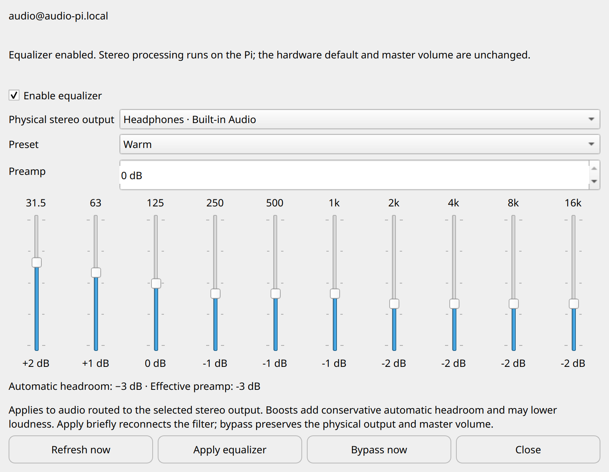
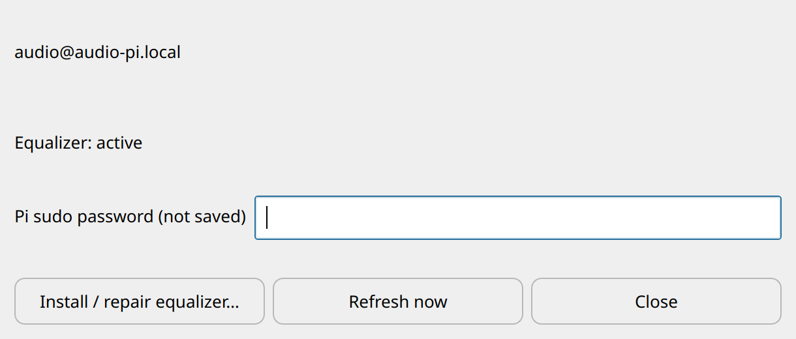

# Per-Pi stereo equalizer (0.9.1 preview)

Open **Equalizer…**, directly beside **Master volume…** in the tray menu, for the selected receiver. This is an
optional add-on for an existing managed Debian/Raspberry Pi OS 13 ARM64 receiver
with PipeWire 1.4 and WirePlumber 0.5. It is not an ALSA/BlueALSA EQ and is not
installed by the fresh-Pi wizard. A core receiver installation comes first.

1. For first installation or repair, open **Maintenance → Check / repair Pi
   components… → Install / repair equalizer…**. Enter the Pi sudo password in
   that separate dialog's masked field and review the confirmation. Installation
   leaves EQ bypassed and existing players running; no runtime sudo rules are added.
2. Open **Equalizer…** from the tray and refresh the discovered physical outputs.
   The playback window contains no administrator password or installation controls.
3. Choose the output actually used by your players. Keep your amplifier at a
   comfortable level for the first test. Enable EQ, choose **Flat**, and Apply.
4. Select a preset or adjust the ten bands and preamp, then Apply again. Slider
   movements only edit the desktop controls; they do not send live commands.
5. **Bypass now** stops and disables the filter, retaining the saved gains and
   physical master volume. Closing the dialog or tray app leaves enabled EQ
   running on the Pi. Reopening/Refresh reads the Pi's saved state.





The controls and saved settings belong to the selected Pi profile/SSH account.
Switching profiles does not copy EQ curves between receivers. Independent Pis
usually need different speaker/room settings.

## Signal path and gain

The fixed builtin PipeWire filter chain has a preamp, ten peaking filters at
31.5, 63, 125, 250, 500, 1k, 2k, 4k, 8k and 16k Hz (Q=1), and a final sample
clamp. Bands accept integer −6…+6 dB; preamp accepts −12…0 dB. Presets are Flat,
Warm, Bass lift, Speech and Soft treble. Custom settings are supported within
these bounds. This is basic EQ, not a convolution engine, room measurement tool,
dynamic compressor or calibrated speaker protection.

Positive gains add automatic attenuation equal to their sum, in addition to the
manual preamp. The displayed effective preamp makes this explicit. Boost-heavy
curves can sound quieter; the physical master volume is independent. Flat at
0 dB has no intentional gain change. Do not compensate by blindly increasing an
amplifier: bypassing an attenuated curve can increase perceived loudness.

WirePlumber's smart-filter policy inserts EQ before one physical stereo output,
identified by its stable PipeWire name. The hardware default and its master
volume remain unchanged. Audio routed to other outputs bypasses EQ. Players
using another audio stack/direct hardware access are outside this path. Spotify,
MPD, AirPlay and Bluetooth using the shared PipeWire session use this output
path, regardless of whether mixing or exclusive source policy is selected.

Processing requests a 48 kHz stereo graph; PipeWire converts other supported
stream rates. Synthetic 44.1 and 48 kHz input tests passed on the reference Pi 3
B+, measuring −6.00 dB on both channels at 1 kHz, zero filter xrun counters, and
2.5–3% of one CPU core in the DSP process over a short sample. This is not an
end-to-end latency or total audio-server CPU benchmark. DSP is not bit-perfect.
Other Pi models, DACs, multichannel outputs and extended running times are not
certified by this test.

## Persistence, failures and recovery

Apply atomically writes private settings and a generated graph into the audio
account's `~/.config/pi-audio-tray/`. Enabling also enables the user service
`pi-audio-dsp.service` at startup. The core receiver's existing user lingering
makes its audio session available without SSH login. Applying changes restarts
only this filter, briefly reconnecting streams. Existing players are not
restarted. Repair leaves the installed filter bypassed; Apply enables it again.

Missing targets are shown as unavailable. Other outputs are not used as a
fallback for the filter. Reconnecting a target with the same stable name lets
WirePlumber reconnect it; a synthetic target-removal/recreation test passed.
Real hardware drivers can expose a different name after reconfiguration, so
select the new output explicitly if needed. The app refuses enabling an absent
output. Bypass still works when the saved preferences are invalid or the output
is gone.

If Apply fails, the helper attempts to restore prior settings, generated graph
and service enablement. If the filter process disappears, WirePlumber restores
direct output routing; the user service also has bounded restart attempts. No
automatic hardware-output/default-device rewrite is needed. A failed repair is
not a transactional installer rollback: inspect the root-private install log and
retry the same reviewed installer if necessary.

From SSH as the managed audio account:

```sh
/usr/local/lib/pi-audio-tray/pi-dsp status
/usr/local/lib/pi-audio-tray/pi-dsp bypass
systemctl --user status pi-audio-dsp.service --no-pager
journalctl --user -u pi-audio-dsp.service --no-pager -n 60
```

Keep logs/configuration private if sharing diagnostics. Never paste credentials.
The helper accepts only `status`, `configure` (bounded JSON stdin) and `bypass`.
It does not expose a new network service or support arbitrary plugin uploads.
See the [security model](../SECURITY.md).

## Reproducing the isolated graph test

The opt-in harness creates and cleans up its own null sink, sine streams,
filter process and monitor recorder. It checks both sample rates/channels,
filter counters, stable-name target reconnection, direct fallback after filter
termination and preservation of the default output. It never uses a microphone
or a real output. As the receiver's audio user, from a source checkout containing
`dsp_config.py` and `tools/check_dsp_graph.py`:

```sh
python3 tools/check_dsp_graph.py --allow-null-probe
```

Do not run as root. This live check is separate from offline regression tests and
does not establish physical speaker playback or reboot persistence. Test those
explicitly on each deployment with the listener's knowledge.

Upstream behavior: [PipeWire filter-chain](https://docs.pipewire.org/page_module_filter_chain.html),
[WirePlumber smart filters](https://pipewire.pages.freedesktop.org/wireplumber/policies/smart_filters.html).
