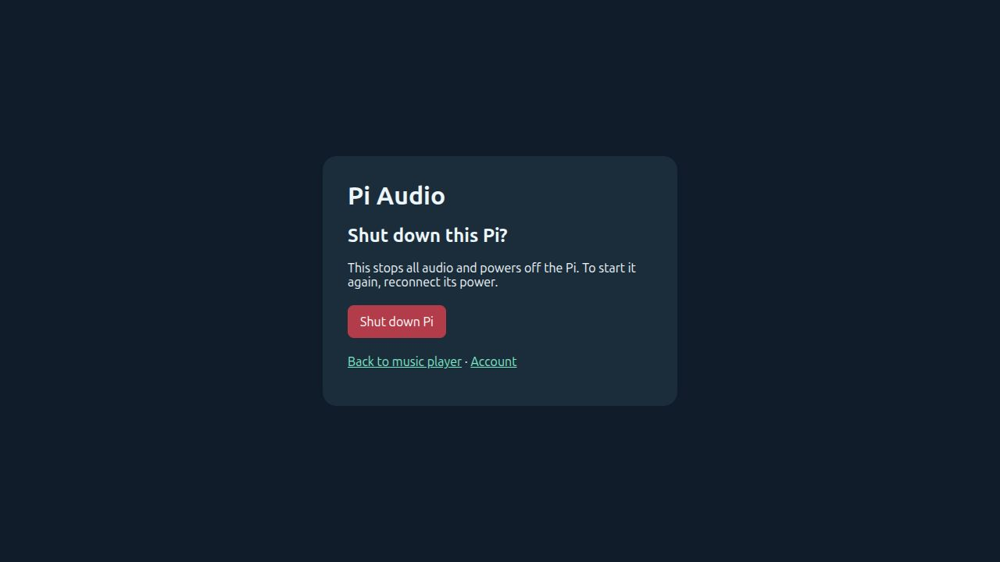

# Optional authenticated web shutdown

An existing Pi Audio HTTPS player can offer **Shut down Pi…** at
`https://audio-pi.local/power`, also linked from `/account` and the signed-in
login page. Use your receiver's existing hostname, password and trusted
certificate. No new TCP port or separate browser credential is introduced.
The myMPD player remains at `/`; this small control page does not enable myMPD
script execution or modify its media interface.

Opening the page never shuts down anything. A signed-in browser sees a
confirmation form explaining that all audio stops and starting the Pi again
requires reconnecting power. The button sends a same-origin POST with CSRF
protection and a session-bound, single-use confirmation token expiring after
two minutes. Replayed forms, another browser's token, expired/revoked logins and
cross-origin requests cannot queue shutdown.

**Every holder of the existing music login can request shutdown once this
optional component is installed.** This is deliberately broader authority than
media playback; it is not a new administrator account or general root shell.

## Install or repair

Requires the existing cookie-login HTTPS setup and its protected system account,
a managed Linux/systemd receiver with the normal APT/dpkg lock files, and the
`apt-daily`, `apt-daily-upgrade` and `soloist-update` service units. The reference
receiver is Pi 3 B+ / Debian 13 ARM64. Other boards/stacks are not certified.
The opt-in installer is separate from the fresh-Pi choices and the component
repair checklist. Desktop updates alone do not grant this capability.

From a checkout on the Pi, with all files in `pi/` together:

```sh
cd pi
sudo /usr/bin/python3 -I install-web-power.py --hostname audio-pi.local
```

Use the exact existing HTTPS hostname. The installer refuses unrelated power
files, snapshots a fixed manifest privately, keeps previous public configuration
under `/var/lib/pi-audio-web-power/before-web-power`, and retains password, session
database, certificates and audio configuration. It restarts the login/proxy
services to load the update; audio services are not restarted. The previous
nginx dependency is retained on failed login configuration rollback. As with
other add-ons, partial installation is not a complete system transaction;
inspect the private backup/state and rerun the reviewed installer after failure.

Installation creates a private systemd Unix socket and two narrow root service
roles, not a new sudo rule. It does not queue shutdown. Its live check sends only
the broker's read-only `check` request.



## Runtime boundary and update protection

The existing login process remains `pi-audio-auth` with `NoNewPrivileges=yes`,
no capabilities and no media access. It can connect to
`/run/pi-audio-power/control.sock` (0600, owned by that exact account). The
socket-activated broker checks Linux peer credentials and accepts only `check`
or `poweroff`. No unit name, command, environment or file path comes from HTTP.
It can queue only the fixed `pi-audio-web-poweroff.service`.

Before queueing, it refuses active/unknown managed updates, an active receiver
setup lock, or held APT/dpkg package-manager locks. The fixed job allows two
seconds for the acknowledgement page to arrive, then repeats those checks
before requesting ordinary graceful poweroff. It explicitly checks inhibitors and does not use force/ignore flags; see
[systemctl inhibitor handling](https://freedesktop.org/software/systemd/man/latest/systemctl.html#--check-inhibitors=). A new update starting during the delay can therefore keep
the Pi online even after an acknowledgement; wait for it to finish and use a
fresh confirmation form. An acknowledgement means requested, not verified off.

These checks coordinate with the existing installers/package managers; they are
not a same-root-user security boundary or a guarantee about every third-party
maintenance task. There is no remote power-on facility.

## Disable and diagnose

To withdraw the web capability while keeping login/music:

```sh
sudo systemctl disable --now pi-audio-power.socket
```

This removes the socket, so the account page hides its shutdown link. A job
already queued is separate; inspect it promptly if needed. To inspect failures:

```sh
systemctl status pi-audio-power.socket pi-audio-web-poweroff.service --no-pager
journalctl -u pi-audio-web-poweroff.service --no-pager -n 30
```

Do not weaken socket permissions or disable service sandboxing to repair a
failure. Confirm the update/setup state, expected account and installed units,
then rerun the reviewed installer. Do not share browser cookies or form tokens.

## Verification

Tests use a mocked shutdown backend and temporary Unix HTTP sockets. They cover
login/Origin/CSRF checks, session-bound expiry/replay, nonce storage limits,
fixed broker commands/peer identity, setup locks and real cross-process package
lock conflicts. Root execution is mocked; CI never powers off a host.
Live deployment checks the private broker with `check`, HTTPS login boundaries
and rejection of an invalid confirmation. A real valid shutdown POST is left
to the user when they actually intend to power off the receiver.
